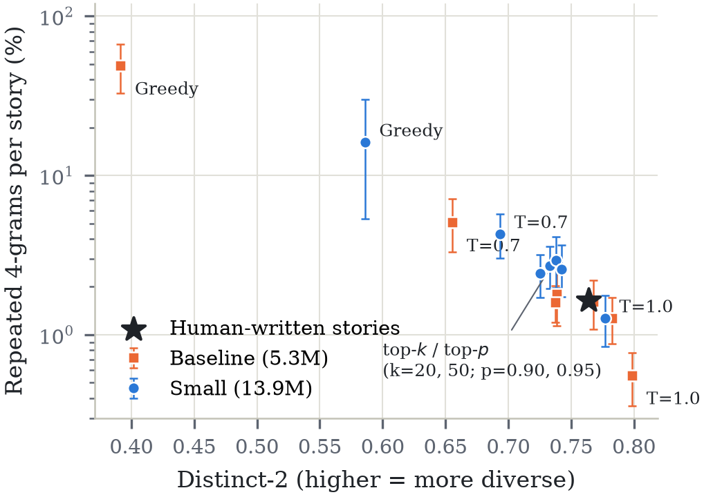
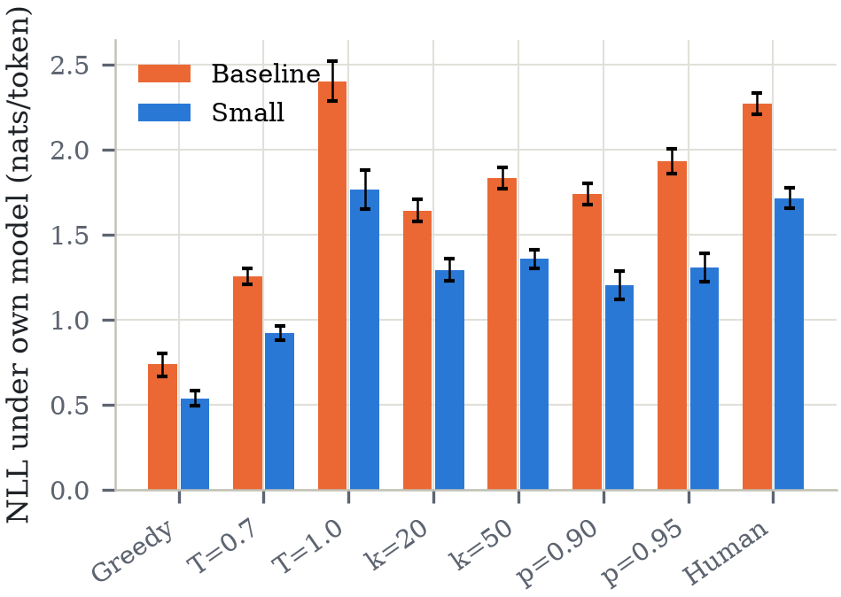
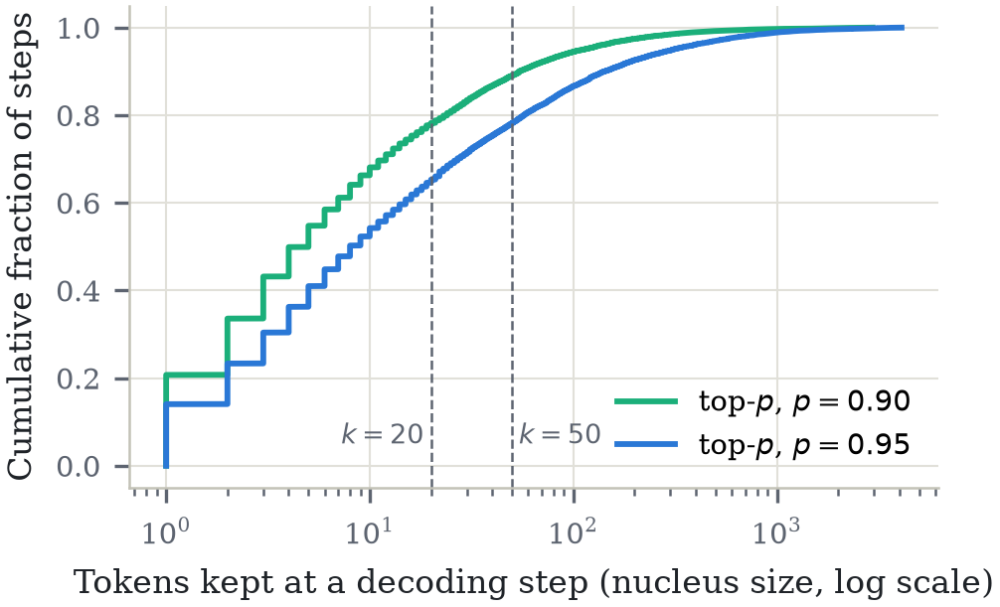
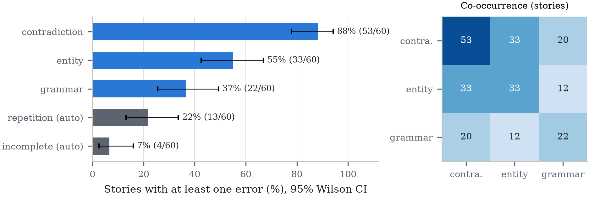

# A Small Autoregressive Transformer Language Model Built from Scratch for Short Story Generation

### *Fluent but inconsistent: what decoding can and cannot fix in small language models*

A GPT-style language model written from scratch in plain PyTorch (tokenizer, causal attention, training loop,
decoding and evaluation, with no pretrained weights and no `transformers` model classes), trained on
[TinyStories](https://arxiv.org/abs/2305.07759) **using only a desktop CPU**, then studied in depth:
how seven decoding rules change the stories, and which errors remain whatever the rule.

> **Once upon a time**, there was a little girl named Lily. She loved to play with her toys and explore the world
> around her. One day, she found a mysterious book about a treasure. […] Her mom was happy and said, "Wow, Lily! You
> did a great job finding the treasure. Now it's yours for you to keep." Lily was so happy and couldn't wait to open
> the book again!
>
> <sub>Written by the 13.9M-parameter model from the prompt "Once upon a time" (top-p 0.95, ~1 s on a CPU). Fluent
> and well-ended, but the facts drift: Lily reads *about* a treasure, then has the treasure.</sub>

| | |
|---|---|
| 🧠 **Model** | 13.9M-parameter decoder-only Transformer (6 layers, 6 heads, width 384, 256-token context) |
| 💻 **Hardware** | one Intel CPU, no GPU: **9.9 h** of training, 1.4 GB peak memory |
| 📉 **Test perplexity** | **5.74** (5.3M baseline: 9.68) on a leakage-free held-out split |
| ⚡ **Speed** | 141 tokens/s, **1.4 s** per 200-token story on the CPU |
| 📄 **Article** | IEEE Access draft with proofs, statistics and figures: [`project1_paper/`](project1_paper/) |
| 🎓 **Tutorial** | interactive beginner's guide with animations built from the real model: [`tutorial/project1.html`](tutorial/project1.html) |

---

## Key findings

### 1. 30% of the TinyStories validation set is also in its training set
Exact matching found that **6,601 of the 21,990 official validation stories (30.0%) appear verbatim in the
training split**, and 15% of the training stories are exact duplicates. Validation scores on the raw corpus
therefore partly measure memorisation. We removed duplicates, truncated stories and the overlap
(2,119,719 → 1,772,187 training stories), and split validation into a validation half and a **test half that
was never used for any decision**. Validation and test perplexity then agree to the third decimal (5.735 vs. 5.739).

### 2. Pure sampling looks best on the usual metrics, but invents words


| Decoding (13.9M model) | Distinct-2 ↑ | Repetitive stories | Ends by itself | **Made-up words** |
|---|---|---|---|---|
| Human-written stories | 0.764 | 5% | – | **0.021%** |
| Greedy | 0.586 | 75% | 88% | 0% |
| Temperature 0.7 | 0.693 | 25% | 92% | 0.014% |
| Temperature 1.0 | **0.777** | **2%** | **100%** | **0.337% (16× human)** |
| Top-k 20 / 50 | 0.733 / 0.726 | 8% / 10% | 95% / 92% | 0.050% / 0% |
| Top-p 0.90 | 0.738 | 10% | 92% | 0% |
| **Top-p 0.95** ✅ | 0.742 | **2%** | 92% | 0.039% |

Temperature 1.0 wins on diversity, repetition and story endings, yet it writes non-words such as *"oripped"*,
*"alreadypow"* and *"neverld"* (p = 1.7·10⁻⁵ vs. top-p 0.95). **Distinct-n counts every invented word as extra
"diversity"**, so it rewards exactly this failure. **Top-p 0.95** is the only rule with no weak point.

### 3. Truncation provably pushes text toward what the model already expects
We prove that **any top-k or top-p truncation lowers the expected per-token surprisal below the model's entropy**,
and measure it: truncated decoders write text the model finds far more probable than human text
(1.20–1.36 vs. 1.72 nats/token). Only pure sampling matches the human level (1.76), which shows the model is well
calibrated.

<p align="center"> </p>

**Why a fixed k fails:** the number of plausible next tokens varies by two orders of magnitude. In 20.7% of steps
one token already holds 90% of the probability (top-20 still adds 19 tail tokens there); in 21.8% of steps
even 20 tokens hold less than 90% (top-20 cuts off good options there). Top-p adapts; top-k cannot.

**A bigger model repeats more under the same top-p** (repeated 4-grams 2.95% vs. 1.60%, p = 0.026): sharper
distributions give smaller nuclei and more mode-seeking decoding.

### 4. The errors that remain are about meaning, not grammar


In 60 annotated stories, **88% contain a contradiction and 55% an entity error, but only 37% a grammatical
error**. Every story with an entity error also contains a contradiction, and errors increase with story length
(Spearman ρ = 0.34, p = 0.008). Typical failures:
- *"a little mouse named Tim. Tim was a very obedient cat"*: the species changes
- *"a new boy… His name was Lily"*: the gender and name change
- a key that becomes a penny, then a coin; a ball that changes owner mid-story

**Decoding fixes surface degeneration (loops, non-words), but no decoding rule fixes narrative consistency.**

---

## Reproduce everything

Tested on Windows 11, Python 3.12.10, `torch==2.14.1+cpu`. Every step runs on a CPU; a GPU is used automatically if
one is available. Full step-by-step explanations are in [`INSTRUCTIONS.md`](INSTRUCTIONS.md).

### 0. Set up the environment
```bash
git clone https://github.com/istiaque010/Autoregressive-Transformer-Language-Model.git
cd Autoregressive-Transformer-Language-Model
python -m venv .venv
.venv\Scripts\activate            # Linux/macOS: source .venv/bin/activate
pip install torch --index-url https://download.pytorch.org/whl/cpu
pip install -r requirements.txt   # exact versions: requirements.lock.txt
python -m pytest -q tests         # 15 tests: causal mask, data pipeline, metrics
```

### 1. Data and tokenizer (~3 GB of disk space)
```bash
python scripts/inspect_data.py                          # download TinyStories, print statistics
python scripts/clean_data.py                            # dedup, remove leakage, make the test split
python scripts/train_tokenizer.py --n_stories 100000 --vocab_size 8192
python scripts/prepare_data.py --n_train 100000         # baseline data   -> data/
python scripts/prepare_data.py --n_train 0 --data_dir data/full   # all stories -> data/full/
```

### 2. Train (1 h + 10 h on a 24-thread CPU)
```bash
python -m src.train --config configs/baseline.yaml      # 5.3M params,  ~1.0 h
python -m src.train --config configs/small.yaml         # 13.9M params, ~9.9 h (overnight)
python scripts/plot_curves.py --run baseline --run small
```
Training resumes after an interruption with `--resume checkpoints/small/model_last.pt`.

### 3. Evaluate
```bash
python -m src.evaluate --ckpt checkpoints/baseline/model_best.pt   # perplexity, 7 decoding rules, speed
python -m src.evaluate --ckpt checkpoints/small/model_best.pt
python scripts/madeup_words.py --run baseline --run small
python scripts/error_labels_small.py                               # apply the error annotations
```

### 4. Rebuild every statistic and figure of the article (~5 min)
```bash
python project1_paper/analysis/paper_analysis.py   # -> project1_paper/analysis/paper_stats.json + figures/
```
Compile [`project1_paper/main.tex`](project1_paper/main.tex) with pdfLaTeX + BibTeX (e.g. on Overleaf).
A preview is in [`project1_paper/main_preview.pdf`](project1_paper/main_preview.pdf).

### Try the model
```bash
python -m src.generate --ckpt checkpoints/small/model_best.pt --prompt "Tom found a little dog" --method top_p --top_p 0.95
python scripts/show_decoding.py --ckpt checkpoints/small/model_best.pt --prompt "Tom was sad because"   # see the probabilities
```

### Teacher package for Project 2
`python scripts/package_teacher.py` builds a self-contained `teacher/` folder (weights, tokenizer, code, test data,
SHA-256 manifest), and `python teacher/verify_teacher.py` reproduces the test perplexity of 5.74 from it alone.
It will be attached to a GitHub Release so that it can be downloaded without retraining.

---

## Repository layout
```
src/             tokenizer, dataset, causal attention, Transformer block, GPT model, training, generation, evaluation
scripts/         data inspection & cleaning, tokenizer, benchmark, plots, decoding demo, made-up words, error labels, packaging
configs/         smoke / baseline / small model configs, evaluation prompts
tests/           causal-mask proofs, pipeline tests, metric tests
results/         metrics (eval.json, training logs), all generated stories, error annotations, figures
tutorial/        interactive HTML tutorial (download the folder and open project1.html in a browser)
project1_paper/  IEEE Access article: main.tex, references.bib, figures, analysis script, preview PDF
INSTRUCTIONS.md  the 14-phase build log: every step, result and decision
```
Not in git (rebuilt by the scripts): `data/` (3.3 GB), `checkpoints/` (2.5 GB), `teacher/` (64 MB, see Releases).

## Design choices worth knowing
- **Pre-LN GPT-2-style block**, learned position embeddings, GELU MLP (4×), weight tying, dropout 0.1, fp32.
- **Causal attention written by hand.** Tests prove that no output depends on future tokens; removing the mask makes
  all three tests fail.
- **Byte-level BPE, 8,192 tokens:** 1.20 tokens per word, no unknown tokens.
- **Metrics calibrated on human text:** a story counts as repetitive only if it repeats more than 95% of real
  stories do; Distinct-n is compared on equal text lengths; speed is measured only when the CPU is otherwise idle.
- **Statistics:** Wilson intervals, bootstrap intervals and tests, and Fisher exact tests; non-significant
  differences are reported as such.

## Limitations
One training seed per model; 8 prompts and 40 stories per decoding rule; the error annotation is a single
first-pass annotation (an independent second annotation is planned); English children's stories only.
See Section VIII of the article.

## Citation
If you use this code or the findings, please cite:
```bibtex
@misc{ahmed2026smallar,
  author       = {Ahmed, Istiaque},
  title        = {Decoding Strategies and Error Analysis for Small Autoregressive Transformer
                  Language Models in Story Generation},
  year         = {2026},
  howpublished = {\url{https://github.com/istiaque010/Autoregressive-Transformer-Language-Model}}
}
```

## Acknowledgements
TinyStories by Eldan & Li (2023). The architecture follows GPT-2 (Radford et al., 2019); top-p sampling follows
Holtzman et al. (2020). Full references are in [`project1_paper/references.bib`](project1_paper/references.bib).
